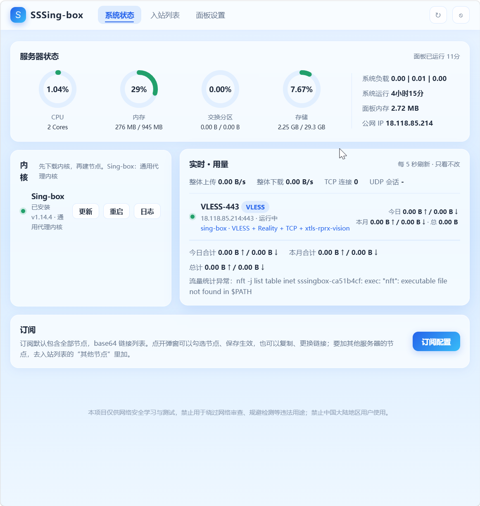
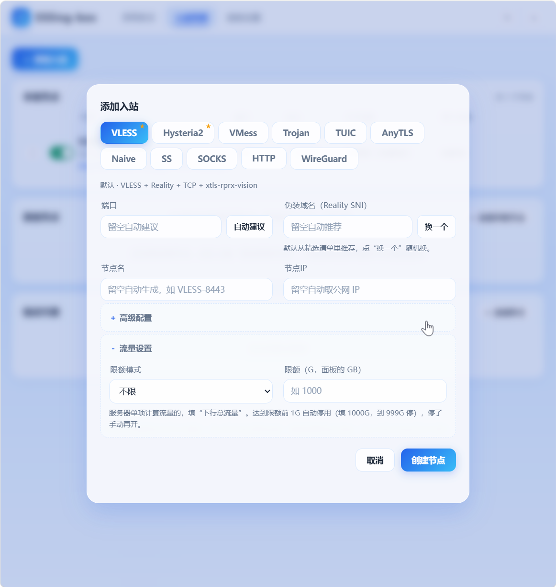
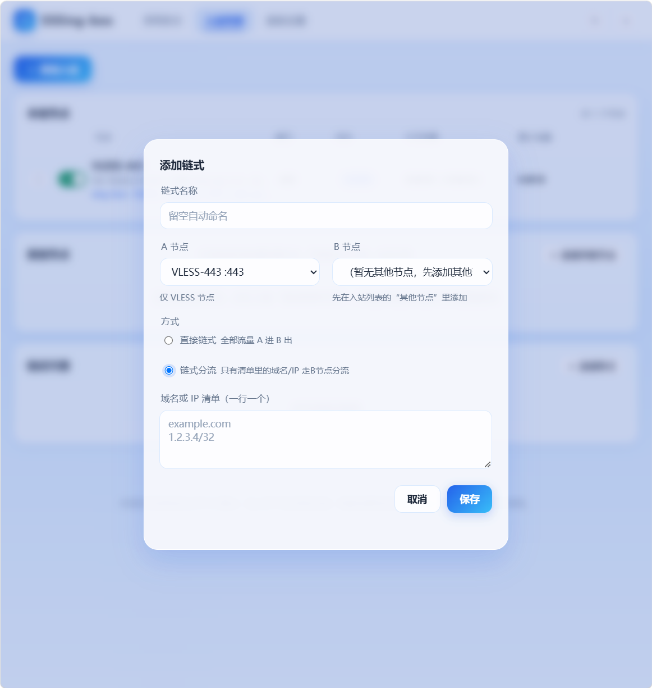
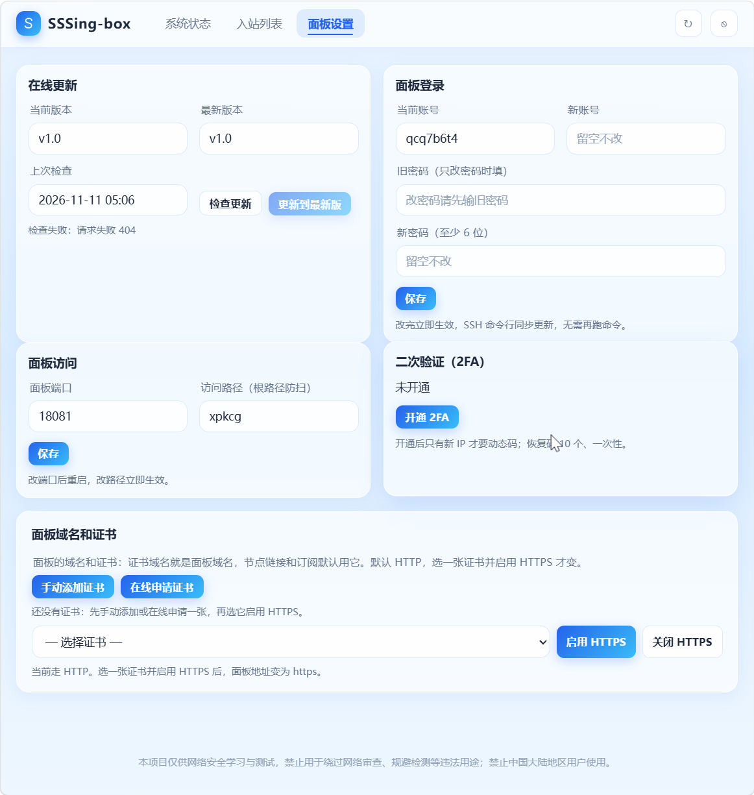

# SSSing-box

单页面代理面板：一个页面管全部节点，基于 sing-box 内核，支持 11 种协议。

**预设最佳配置，一键安装，一键配置，极简。** 节点默认就是最优档位（VLESS + Reality + TCP + xtls-rprx-vision 等），不用一个个参数调；装完就能用，不用再配。

## 一键安装

```bash
curl -fsSL https://raw.githubusercontent.com/SSStingg/SSSing-box/main/install.sh | bash
```

装完直接打印面板地址、账号、密码（自动生成）。






## 支持的协议

VLESS、Hysteria2、VMess、Shadowsocks、SOCKS5、HTTP、Trojan、WireGuard、TUIC、AnyTLS、Naive（含 Reality / WS / H2 / HTTPUpgrade / CF 等搭建方式）。

## SSH 菜单

```bash
sssingbox
```

## 卸载

```bash
curl -fsSL https://raw.githubusercontent.com/SSStingg/SSSing-box/main/install.sh | bash -s uninstall   # 数据目录保留，彻底删除：rm -rf /var/lib/sssingbox
```

本地已有 install.sh 时，`bash install.sh uninstall` 也一样。

## 自己编译

```bash
go build -o sssingbox .
./sssingbox -data /var/lib/sssingbox -port 18081
```

不带版本号编译出来是 dev 版，在线更新会拒绝 dev 版；需要版本号时编译加 `-ldflags "-X sssingbox/internal/version.Version=<标签>"`。

## 法律声明

<small>本项目（SSSing-box）是一个 sing-box 代理管理面板，仅供网络安全学习、研究与测试使用。<br>本项目不提供、不鼓励任何绕过网络审查、规避检测、非法访问受限内容的行为。使用者应当遵守所在国家和地区的法律法规，并自行承担使用本项目的一切责任。<br>根据中国大陆地区相关法律法规，本项目明确禁止中国大陆地区用户部署与使用。如您是中国大陆居民，请勿部署或使用本项目。<br>本项目按“现状”提供，作者不提供任何明示或暗示的担保，不对使用本项目造成的任何后果承担责任。</small>
